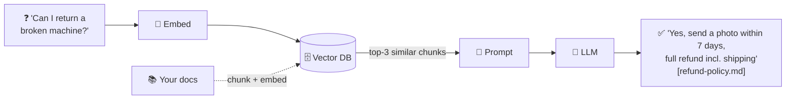

# Vector DBs & RAG — From Zero to a Working Demo

A beginner-friendly, **30-minute** walkthrough of **vector databases** and **Retrieval-Augmented Generation (RAG)**, with diagrams, a slide deck, and a sample RAG app that runs on a plain **Windows laptop** (no GPU, no paid account).



---

## 🚀 Quick start (Windows, ~10 min)

```powershell
git clone https://github.com/Sreenivas-Ratakonda/vector-db-and-rag.git
cd vector-db-and-rag
Set-ExecutionPolicy -Scope Process -ExecutionPolicy Bypass
.\setup.ps1
.\.venv\Scripts\Activate.ps1

python rag\step1_embeddings.py               # what is an embedding?
python rag\step2_rag_without_vectordb.py     # RAG with just numpy
python rag\step3_rag_with_chromadb.py        # RAG with a vector DB (interactive)
```

macOS / Linux: `./setup.sh && source .venv/bin/activate`, then the same commands with `/`.

**Want real generated answers?** Install [Ollama](https://ollama.com) (`winget install -e --id Ollama.Ollama`, then `ollama pull llama3.2`) or set `ANTHROPIC_API_KEY` / `OPENAI_API_KEY`. Without an LLM, the demos still show retrieval, which is the core idea. Full guide: [docs/04-windows-setup.md](docs/04-windows-setup.md).

---

## 📚 Learning path

| # | Read | You'll learn | Demo |
|---|---|---|---|
| 1 | [Vector DB basics](docs/01-vector-db-basics.md) | Embeddings, similarity, vector DB vs SQL/NoSQL/search, indexes (HNSW, IVF, PQ), types of vector DBs | `step1_embeddings.py` |
| 2 | [RAG basics](docs/02-rag-basics.md) | Why LLMs need RAG, the pipeline, chunking, prompts, RAG vs fine-tuning | `step2_rag_without_vectordb.py` |
| 3 | [Vector DB meets RAG](docs/03-vector-db-meets-rag.md) | Where the vector DB fits, **when RAG needs one and when it doesn't**, hybrid search | `step3_rag_with_chromadb.py` |
| 4 | [Setup guide](docs/04-windows-setup.md) | Windows install, plugging in an LLM, troubleshooting | — |
| 5 | [Presenter guide](docs/05-presenter-guide.md) | Minute-by-minute 30-min script, demo cues, Q&A cheat sheet | — |
| 🎞️ | [`slides/index.html`](slides/index.html) | Slide deck: open in a browser, use ← → keys | — |

---

## 🗂️ Repo layout

```
vector-db-and-rag/
├── README.md
├── setup.ps1 / setup.sh          one-command setup
├── requirements.txt              chromadb + numpy (that's it)
├── slides/index.html             offline slide deck for the talk
├── docs/                         concepts, diagrams, setup, presenter script
├── data/                         sample knowledge base (fictional "Brewly Coffee Co.")
│   ├── refund-policy.md   leave-policy.md   it-security.md
│   └── product-faq.md     onboarding.md
└── rag/
    ├── common.py                 load, chunk, embed (local MiniLM model)
    ├── llm.py                    Ollama / Claude / OpenAI / no-LLM (std-lib only)
    ├── step1_embeddings.py       text -> vectors, similarity, keyword vs semantic
    ├── step2_rag_without_vectordb.py   RAG with an in-memory numpy matrix
    └── step3_rag_with_chromadb.py      RAG with ChromaDB: persist, filter, interactive
```

## 🧪 The three demos

| Demo | What it proves |
|---|---|
| **Step 1:** embeddings | "money back" ≈ "refund" with **zero shared words**. Keyword search fails where vector search succeeds. |
| **Step 2:** RAG, no vector DB | The whole RAG loop in ~40 lines. For small data, a numpy matrix *is* your vector store. |
| **Step 3:** RAG + ChromaDB | What a real vector DB adds: **persistence**, **ANN index**, **metadata filters** (`--source`), **citations**. |

Try your own documents: drop `.md`/`.txt` files into `data/` and run `python rag/step3_rag_with_chromadb.py --reset`.

---

## ⚡ Cheat sheet

| Term | Plain English |
|---|---|
| **Embedding** | A list of numbers representing meaning. Similar meaning, similar numbers. |
| **Vector DB** | A database that finds the *most similar* vectors fast. |
| **Cosine similarity** | How closely two vectors point the same way (1 = identical meaning). |
| **ANN / HNSW** | Shortcut search structures, so you don't compare against every vector. |
| **Chunk** | A small piece of a document (a paragraph or section) that gets embedded. |
| **RAG** | Retrieve relevant chunks, put them in the prompt, let the LLM answer from them. |
| **Top-k** | How many chunks to retrieve (usually 3–5). |
| **Hybrid search** | Keyword + vector search combined. The production default. |
