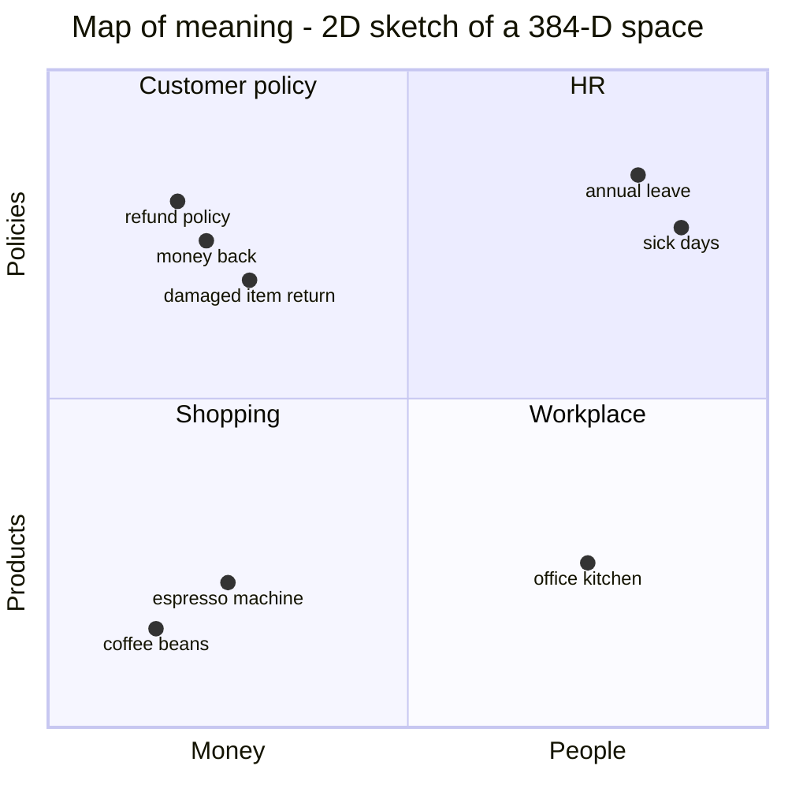
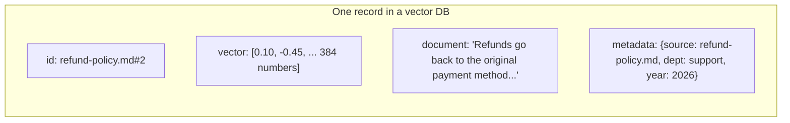
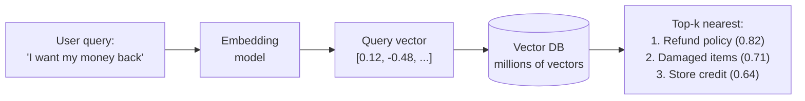
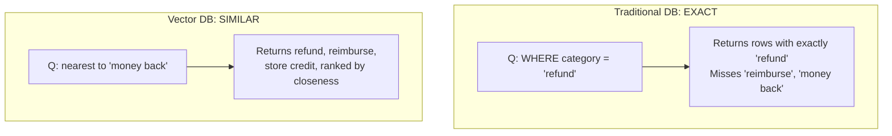
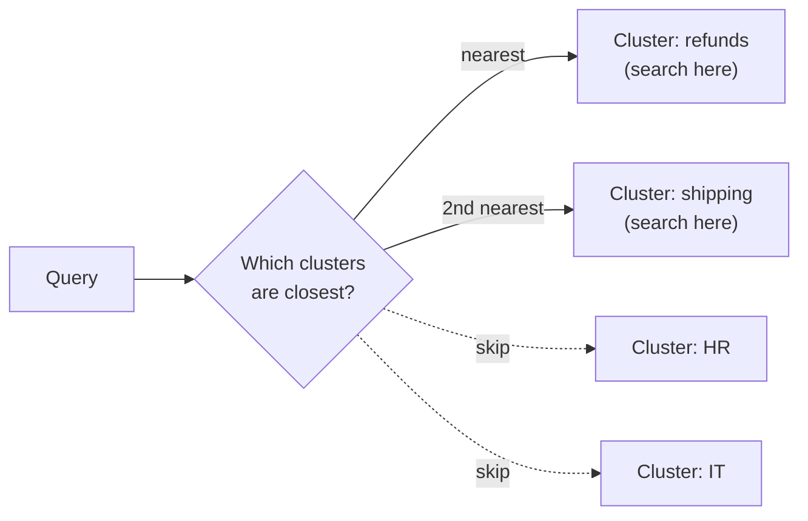
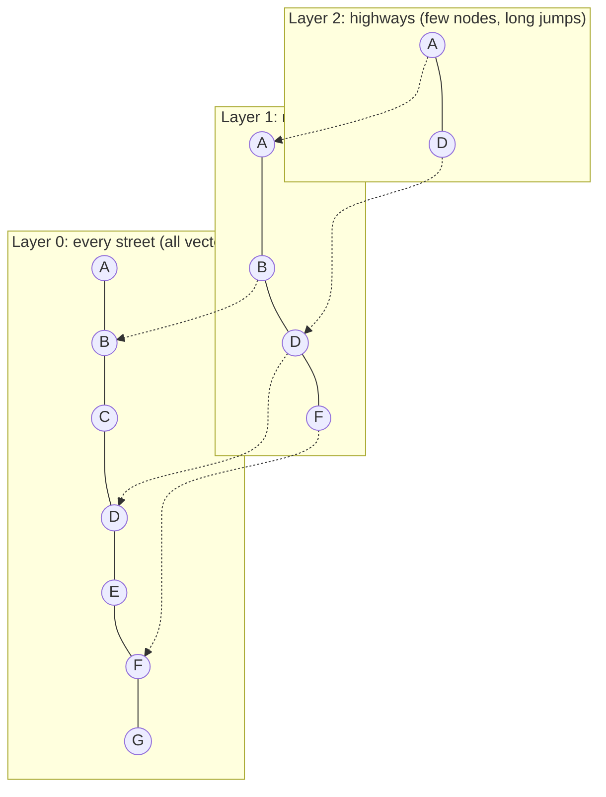
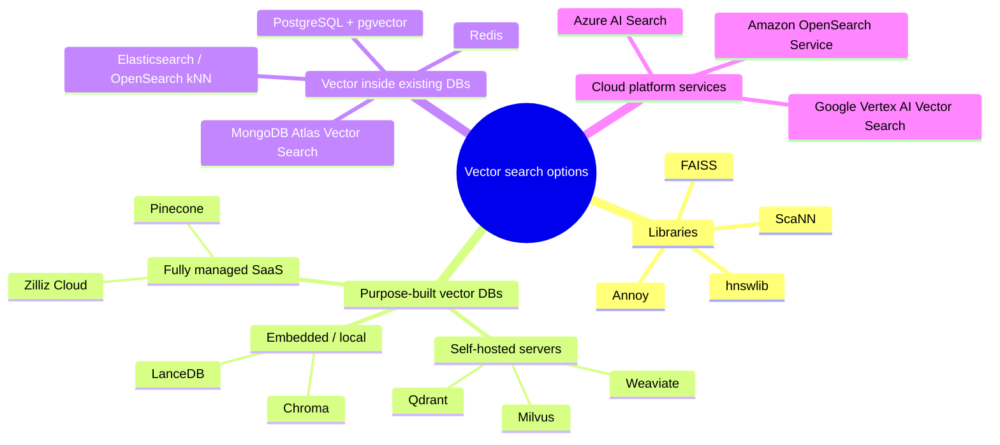

# 1. Vector Databases — The Basics

> **One-liner:** A vector database stores data as lists of numbers that capture *meaning*, and finds the items whose meaning is *closest* to your query, instead of exact matches.

---

## 1.1 The problem: computers match words, people mean things

A customer types: **"I want my money back"**

Your policy document says: **"Refunds are issued within 5–7 business days."**

```sql
SELECT * FROM docs WHERE text LIKE '%money back%';   -- 0 rows. Zero words in common.
```

A traditional database looks for **exact** values or keywords. It has no idea that *money back* ≈ *refund*. That gap is what vector databases close.

---

## 1.2 Embeddings: turning meaning into coordinates

An **embedding model** is a neural network that converts text (or images or audio) into a fixed-length list of numbers called a **vector**.

```
"I want my money back"         -> [0.12, -0.48, 0.33, ..., 0.07]   (384 numbers)
"What is the refund policy?"   -> [0.10, -0.45, 0.31, ..., 0.09]   <- very similar!
"How many leave days do I get?"-> [-0.62, 0.21, -0.05, ..., 0.44]  <- very different
```

**Analogy: GPS for meaning.** Every sentence gets coordinates on a "map of meaning". Sentences that mean similar things land near each other, even with no shared words.



Real embeddings have hundreds or thousands of dimensions (MiniLM: 384, many API models: 768–3072). We can't draw that, but the idea is identical: **close = similar meaning.**

---

## 1.3 Measuring "close": similarity metrics

| Metric | Intuition | Range | Typical use |
|---|---|---|---|
| **Cosine similarity** | Angle between two arrows (direction, ignores length) | -1 … 1 (1 = same) | Text embeddings — the default |
| **Dot product** | Angle × length | unbounded | Normalised vectors (same ranking as cosine) |
| **Euclidean (L2)** | Straight-line distance between points | 0 … ∞ (0 = same) | Images, some models |

```
            refund policy
               ^
              /   <- small angle = similar (cosine ~ 0.8)
             / 
            /____> money back
            \
             \
              \   <- large angle = unrelated (cosine ~ 0.1)
               v
            annual leave
```

---

## 1.4 So what *is* a vector database?

A vector database stores, for each item:



…and answers one core question extremely fast:

> **"Give me the k items whose vectors are nearest to this query vector."**
> (also called **k-NN** or **similarity search**)



---

## 1.5 Vector DB vs traditional databases

| | Relational (PostgreSQL, MySQL) | NoSQL / Document (MongoDB) | Search engine (Elasticsearch) | **Vector DB** |
|---|---|---|---|---|
| **Stores** | Rows & columns | JSON documents | Text + inverted index | **Vectors** + metadata |
| **Query** | `WHERE price < 10` | `{dept: "HR"}` | Keywords (BM25) | **"Find similar to this"** |
| **Match type** | Exact / range | Exact / range | Lexical (words) | **Semantic (meaning)** |
| **Answer** | Exact result set | Exact result set | Ranked by word relevance | **Ranked by similarity** |
| **Index** | B-tree, hash | B-tree | Inverted index | **ANN: HNSW, IVF, PQ** |
| **Great for** | Transactions, reports, joins | Flexible schemas | Log search, keyword search | **Semantic search, RAG, recommendations** |
| **Bad at** | Meaning, fuzzy matches | Meaning | Synonyms, paraphrases | Exact filters, joins, transactions, totals |



> **Key message:** Vector DBs don't *replace* traditional databases. They answer a different question. Most real systems use both.

---

## 1.6 How is search fast? Indexes (ANN)

Comparing the query with **every** vector (brute force) is exact but `O(N)`. With 100 million vectors that's too slow. Vector DBs use **Approximate Nearest Neighbour (ANN)** indexes: trade a tiny bit of accuracy for huge speed.

### Flat / brute force
Compare with everything. 100% accurate. Fine up to ~100k vectors. *(Our step 2 demo.)*

### IVF — Inverted File Index ("search only the right neighbourhoods")

Vectors are grouped into clusters up-front; a query only scans the few nearest clusters (`nprobe`).

### HNSW — Hierarchical Navigable Small World ("highways, then local streets")

Search starts at the top layer, greedily hops toward the query, drops a layer, repeats. It's the default in Chroma, Qdrant, Weaviate, pgvector, Milvus and others. Very fast, high recall, uses more RAM.

### PQ — Product Quantization ("compress the vectors")
Splits each vector into pieces and stores a short code instead of full floats, which cuts memory 10–60×. Often combined: **IVF-PQ**.

| Index | Speed | Accuracy | Memory | When |
|---|---|---|---|---|
| Flat | Slow at scale | 100% | High | < 100k vectors, prototypes |
| IVF | Fast | ~95–99% | Medium | Large, static datasets |
| **HNSW** | **Very fast** | **~95–99%+** | High | **Default choice** |
| IVF-PQ | Fast | ~90–95% | **Very low** | Billions of vectors |

---

## 1.7 Types of vector databases



| Type | Examples | Pros | Cons | Pick when |
|---|---|---|---|---|
| **Library** | FAISS, hnswlib | Fastest, free, no server | No persistence/CRUD/filters out of the box; you build the rest | Research, batch jobs, inside your own service |
| **Embedded DB** | Chroma, LanceDB | `pip install`, zero ops, runs in-process | Single machine | Learning, prototypes, small apps, **this repo** |
| **Self-hosted DB** | Qdrant, Milvus, Weaviate | Full features, scale-out, open source | You run and operate it | Production, data must stay in your infra |
| **Managed SaaS** | Pinecone, Zilliz | No ops, autoscaling | Cost, data leaves your infra | Teams that want speed to production |
| **Extension of existing DB** | pgvector, Elasticsearch, MongoDB, Redis | One system, SQL + vectors together, joins and transactions | May trail purpose-built DBs at very large scale | You already run that DB (very common choice) |

### How to choose (rule of thumb)
1. **Already on Postgres?** Start with **pgvector**.
2. **Learning or prototyping?** Use **Chroma** (this repo) or FAISS.
3. **Millions to billions of vectors, heavy filtering, multi-tenant?** Use **Qdrant / Milvus / Weaviate / Pinecone**.
4. **Need keyword + vector (hybrid)?** Use **Elasticsearch/OpenSearch, Weaviate, Qdrant**, or Postgres full-text plus pgvector.

---

## 1.8 Where else are vector DBs used (beyond RAG)?

- **Semantic search:** search docs or tickets by meaning
- **Recommendations:** "customers who liked this also liked…" (product or user vectors)
- **Image / audio search:** reverse image search, find similar songs
- **Deduplication:** find near-duplicate tickets, records, or images
- **Anomaly detection:** vectors far from everything else are suspicious
- **Long-term memory for AI agents**

➡️ Next: [RAG basics](02-rag-basics.md)
