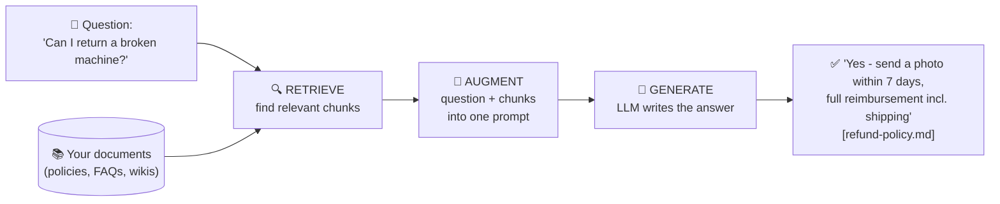
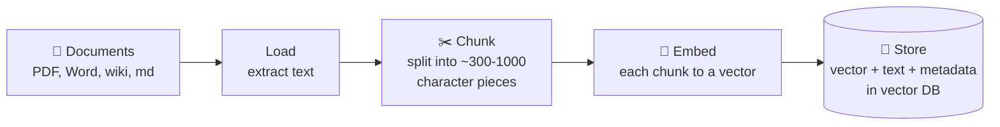
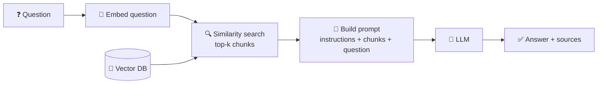
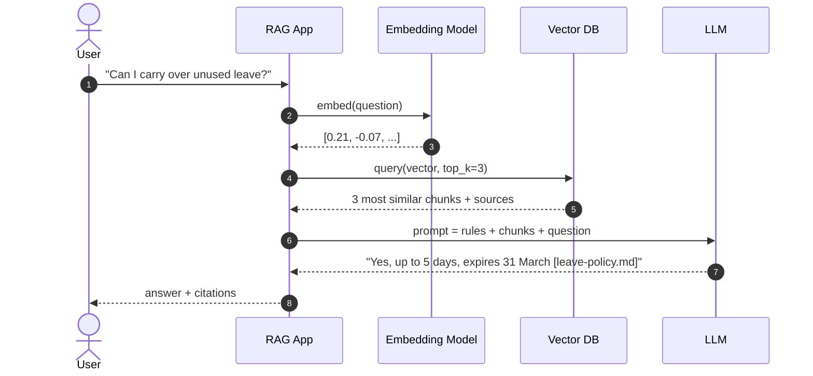
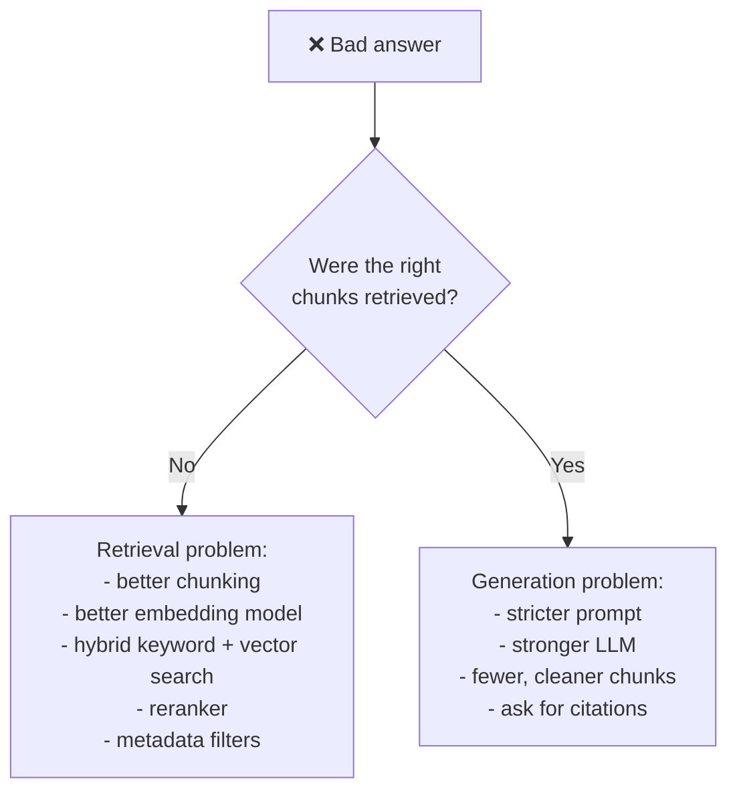

# 2. RAG — Retrieval-Augmented Generation

> **One-liner:** RAG = **look up** the relevant facts first, then let the LLM **answer using those facts**.

---

## 2.1 Why do we need RAG? What LLMs can't do alone

| Problem | Example |
|---|---|
| 🗓️ **Knowledge cutoff** | Trained months ago, so it doesn't know this week's price change |
| 🔒 **No private data** | Never saw *your* HR policy, tickets, or runbooks |
| 🤥 **Hallucination** | Confidently invents a plausible "refund window of 14 days" |
| 📏 **Limited context** | You can't paste 50,000 pages into every prompt |
| 🔍 **No citations** | You can't verify where an answer came from |

**Analogy: the open-book exam.**
- Plain LLM = a closed-book exam. Smart student, answers from memory, sometimes bluffs.
- **RAG = an open-book exam.** Before answering, the student flips to the right pages of *your* textbook and answers from them.

---

## 2.2 RAG in one picture



**R**etrieval → **A**ugmented → **G**eneration.

---

## 2.3 The two phases

### Phase 1: Indexing (offline, done once or whenever docs change)



### Phase 2: Querying (online, on every question)



### Same thing as a timeline



---

## 2.4 The building blocks

| Block | What it does | In this repo |
|---|---|---|
| **Loader** | Reads files and extracts text | `load_documents()` in `rag/common.py` |
| **Chunker** | Splits text into retrievable pieces | `chunk_text()`, ~350 chars by paragraph |
| **Embedding model** | Text to vector | all-MiniLM-L6-v2, local and free |
| **Vector store** | Saves and searches vectors | numpy (step 2) / ChromaDB (step 3) |
| **Retriever** | Gets top-k chunks for a question | `matrix @ q` / `collection.query()` |
| **Prompt template** | Instructions + context + question | `PROMPT_TEMPLATE` in `rag/llm.py` |
| **LLM** | Writes the final answer | Ollama, Claude, OpenAI, or none |

### The prompt is where the magic is visible

```text
You are a helpful assistant for Brewly Coffee Co. employees.
Answer the question using ONLY the context below.
If the answer is not in the context, say "I don't know based on the provided documents."
Cite the source file names you used in square brackets.

Context:
[leave-policy.md]
Full-time employees get 24 days ... Up to 5 unused days can be carried over ...

Question: Can I carry over unused leave?
Answer:
```

The LLM isn't "remembering". It's **reading** what retrieval handed it.

---

## 2.5 The smallest RAG you can write (~25 lines)

```python
# pip install chromadb
import chromadb

docs = {
    "refund": "Refunds are paid to the original payment method within 5-7 business days.",
    "leave":  "Employees get 24 days of annual leave; 5 unused days carry over.",
    "it":     "Report a lost laptop to the IT helpdesk within 1 hour.",
}

# 1. INDEX: Chroma embeds the text for you with a small local model
db = chromadb.Client()
col = db.create_collection("demo")
col.add(ids=list(docs), documents=list(docs.values()))

# 2. RETRIEVE
question = "How do I get my money back?"
hits = col.query(query_texts=[question], n_results=1)
context = hits["documents"][0][0]

# 3. AUGMENT
prompt = f"Answer using only this context:\n{context}\n\nQuestion: {question}"

# 4. GENERATE: send `prompt` to any LLM (Ollama, Claude, OpenAI...)
print(prompt)
```

The full versions are in [`rag/`](../rag).

---

## 2.6 Knobs that matter

| Knob | Too small | Too big | Start with |
|---|---|---|---|
| **Chunk size** | Facts split across chunks; missing context | Noisy chunks; diluted similarity | 300–1000 chars, by paragraph or section |
| **Chunk overlap** | Sentences cut in half | Duplicate content | 10–15% |
| **Top-k** | Misses needed info | Floods the prompt with noise | 3–5 |
| **Embedding model** | Weak semantic matching | Slower, costlier | MiniLM locally; a stronger API model in production |

---

## 2.7 RAG vs the alternatives

| Approach | How | Good for | Weakness |
|---|---|---|---|
| **Prompt only** | Just ask the LLM | General knowledge | No private or fresh data; hallucinates |
| **Long context ("stuff it all")** | Paste whole docs into the prompt | Small doc sets (fits in context) | Cost and latency per call; doesn't scale |
| **RAG** | Retrieve relevant pieces, then answer | Large, changing, private knowledge with citations | Answer quality depends on retrieval quality |
| **Fine-tuning** | Retrain model weights on your data | Style, format, domain behaviour | Expensive; facts go stale; no citations |

> **Rule of thumb:** RAG for **knowledge**, fine-tuning for **behaviour**. They can be combined.

---

## 2.8 Why RAG fails (and fixes)



**Always debug retrieval first:** print the retrieved chunks. Every demo in this repo does that.

➡️ Next: [How vector DBs and RAG fit together](03-vector-db-meets-rag.md)
