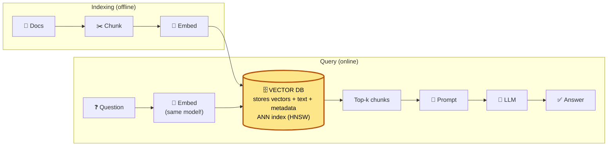
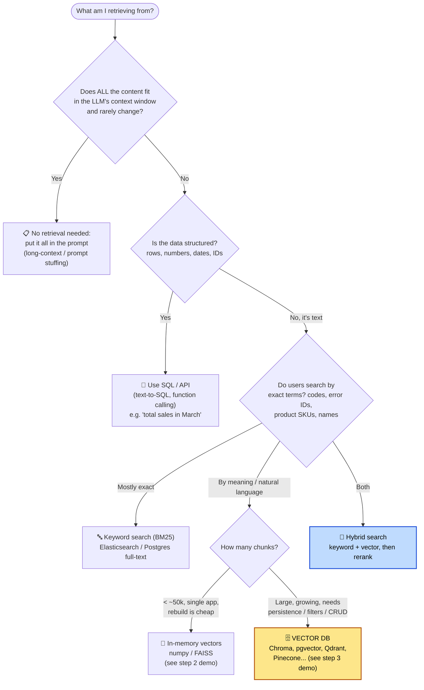
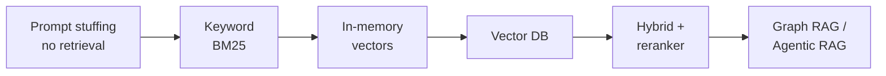
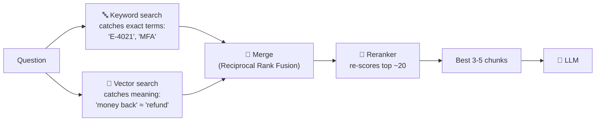

# 3. Where Vector DBs Meet RAG — and When You Don't Need One

> **One-liner:** In RAG, the vector DB is the **"R"**, the retrieval engine. But retrieval doesn't *always* need a vector DB.

---

## 3.1 Where the vector DB sits

> ⚠️ **Same model for documents and questions.** Vectors from different embedding models live in different "maps" and can't be compared.

### What the vector DB contributes

| Need in RAG | Vector DB feature |
|---|---|
| Find chunks by **meaning**, not keywords | Similarity search over embeddings |
| Stay fast with **millions** of chunks | ANN indexes (HNSW / IVF) |
| Don't re-embed on every restart | **Persistence** |
| "Only search HR docs" / "only 2026 policies" / "only this customer's data" | **Metadata filtering** |
| Docs change daily | **Add / update / delete** single records |
| Many users at once, multi-tenant | Concurrency, sharding, replication, access control |
| Show where the answer came from | Store **source metadata** next to each vector |

---

## 3.2 Does my RAG need a vector DB?

**RAG ≠ vector DB.** RAG means *retrieve, then generate*. The retriever can be anything that finds relevant context.

### You **need** a vector DB when…

- ✅ The corpus is **large** (100k+ chunks) or **growing**
- ✅ Users ask in **natural language** and wording differs from the docs
- ✅ You need **persistence** (don't re-embed everything on each start)
- ✅ You need **metadata filters**: department, date, tenant, access level
- ✅ Docs are **updated frequently**, so you need per-document add/update/delete
- ✅ **Many concurrent users** or multiple services share the index

### You **don't** need a vector DB when…

| Situation | Better choice | Example question |
|---|---|---|
| Content is small (a few docs) | Put it all in the prompt | "Summarise our 3-page travel policy" |
| Data is **structured** | SQL / API / function calling | "How many orders shipped last week?" |
| Queries are **exact identifiers** | Keyword search (BM25) | "Error `E-4021`?", "SKU BRW-778?" |
| Small corpus, single process | In-memory numpy / FAISS | Internal demo with 500 FAQ entries |
| Real-time public info | Web search API | "Today's coffee bean futures price?" |
| Answer comes from a live system | Tool / API call | "What's the status of ticket 12345?" |

> 💡 **Use what you already have.** If you already run Postgres or Elasticsearch, add **pgvector** or **kNN** before introducing a new database.

---

## 3.3 Retrieval options: a spectrum

| Level | Setup | Handles synonyms | Scales | Filters/CRUD |
|---|---|---|---|---|
| Prompt stuffing | None | ✅ (LLM reads all) | ❌ | ❌ |
| Keyword (BM25) | Low | ❌ | ✅ | ✅ |
| In-memory vectors | Low | ✅ | ⚠️ RAM-bound | ❌ |
| **Vector DB** | Medium | ✅ | ✅ | ✅ |
| **Hybrid + rerank** | Medium–high | ✅ | ✅ | ✅ (best quality) |

### Hybrid search (what most production RAG uses)

---

## 3.4 Summary slide

| | Vector DB | RAG |
|---|---|---|
| **What** | A database that searches by meaning | A pattern: retrieve, then generate |
| **Role** | The retrieval engine | The overall application |
| **Can exist without the other?** | ✅ Search, recommendations, dedup | ✅ SQL-RAG, keyword-RAG, prompt stuffing |
| **Together** | ⭐ The most common way to build "chat with your documents" | |

➡️ Next: [Windows setup and running the demos](04-windows-setup.md)
