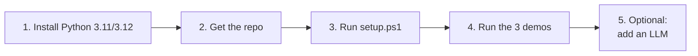

# 4. Setup Guide — Windows (also macOS / Linux)

Time needed: **~10 minutes**. No GPU, no paid account, no Docker.



---

## Step 1: Install Python (skip if `python --version` shows 3.10–3.12)

Open **PowerShell** and run:

```powershell
winget install -e --id Python.Python.3.12
```

Or download from [python.org](https://www.python.org/downloads/windows/) and **tick "Add python.exe to PATH"** on the first installer screen.

Close and reopen PowerShell, then check:

```powershell
python --version      # Python 3.12.x
```

> Python 3.13 also works. 3.11/3.12 is the safest choice for every package.

## Step 2: Get the repo

```powershell
git clone https://github.com/Sreenivas-Ratakonda/vector-db-and-rag.git
cd vector-db-and-rag
```

No git? Download the ZIP from GitHub (**Code → Download ZIP**), extract it, and `cd` into the folder.

## Step 3: One-command setup

```powershell
Set-ExecutionPolicy -Scope Process -ExecutionPolicy Bypass   # allows the script for this window only
.\setup.ps1
```

This creates a virtual environment in `.venv`, installs `chromadb` and `numpy`, and downloads the small embedding model (~80 MB, one time).

<details>
<summary>Prefer to do it manually?</summary>

```powershell
python -m venv .venv
.\.venv\Scripts\Activate.ps1
python -m pip install --upgrade pip
pip install -r requirements.txt
```
</details>

## Step 4: Run the demos

```powershell
.\.venv\Scripts\Activate.ps1          # once per new PowerShell window: (.venv) appears in the prompt

python rag\step1_embeddings.py                        # what embeddings are
python rag\step2_rag_without_vectordb.py              # RAG with plain numpy
python rag\step3_rag_with_chromadb.py                 # RAG with a vector DB (interactive)
python rag\step3_rag_with_chromadb.py "How many sick days do I get?"
python rag\step3_rag_with_chromadb.py --source leave-policy.md "carry over unused days"
```

With **no LLM configured**, the demos still work. They show the retrieved chunks and the most relevant sentences. That's the "R" of RAG, and it's enough to explain the concept.

## Step 5 (optional): Plug in an LLM for real answers

Pick **one**.

### Option A: Ollama (free, local, offline) ⭐ recommended for demos
```powershell
winget install -e --id Ollama.Ollama
ollama pull llama3.2          # ~2 GB, one time
python rag\step3_rag_with_chromadb.py "Can I return a broken espresso machine?"
```
The scripts auto-detect Ollama running on `localhost:11434`. Use another model with `$env:OLLAMA_MODEL="qwen2.5:3b"`.

### Option B: Claude API
```powershell
$env:ANTHROPIC_API_KEY = "sk-ant-..."
python rag\step3_rag_with_chromadb.py "Can I return a broken espresso machine?"
```

### Option C: OpenAI API
```powershell
$env:OPENAI_API_KEY = "sk-..."
```

Force a provider: `$env:RAG_LLM = "ollama"` / `"anthropic"` / `"openai"` / `"none"`.

## Use your own documents

1. Drop `.md` or `.txt` files into `data\`
2. Rebuild the index: `python rag\step3_rag_with_chromadb.py --reset`

---

## macOS / Linux

```bash
./setup.sh
source .venv/bin/activate
python rag/step1_embeddings.py
```

---

## Troubleshooting

| Symptom | Fix |
|---|---|
| `python` opens the Microsoft Store | Settings → Apps → Advanced app settings → **App execution aliases** → turn off `python.exe` / `python3.exe`, then reinstall Python with "Add to PATH" |
| `.\setup.ps1 cannot be loaded because running scripts is disabled` | Run `Set-ExecutionPolicy -Scope Process -ExecutionPolicy Bypass` first (current window only) |
| `pip install chromadb` fails building wheels | Use Python 3.11 or 3.12: `winget install -e --id Python.Python.3.12`, then `py -3.12 -m venv .venv` |
| `[warn] Could not load MiniLM model` | First run needs internet (corporate proxy?). Set `$env:HTTPS_PROXY="http://proxy:port"` and rerun. Demos still work with the keyword-level fallback |
| Results look odd after changing docs or model | `python rag\step3_rag_with_chromadb.py --reset` |
| `ollama call failed` | Start the Ollama app (tray icon) and check `ollama list` shows your model |
| Want a clean slate | Delete the `.venv` and `chroma_db` folders, rerun `.\setup.ps1` |

➡️ Presenting this? See the [30-minute presenter guide](05-presenter-guide.md).
