# 5. Presenter Guide — 30-Minute Talk

**Audience:** anyone (devs, managers, students). **No prior AI knowledge needed.**
**Materials:** `slides/index.html` (open in any browser, arrow keys to navigate) plus a terminal with the demos.

```mermaid
gantt
    title 30-minute talk plan
    dateFormat mm
    axisFormat %M min
    section Intro
    Hook - the money-back problem      :a1, 00, 3m
    section Vector DBs
    Embeddings + similarity            :a2, after a1, 4m
    DEMO step 1                        :crit, a3, after a2, 2m
    Vector DB vs traditional, indexes, types :a4, after a3, 4m
    section RAG
    Why RAG + pipeline                 :a5, after a4, 4m
    DEMO step 2                        :crit, a6, after a5, 2m
    section Together
    Where vector DB fits + when not    :a7, after a6, 4m
    DEMO step 3                        :crit, a8, after a7, 3m
    section Close
    Takeaways + Q&A                    :a9, after a8, 4m
```



---

## Before the talk (5 min checklist)

- [ ] `.\setup.ps1` already done and the embedding model downloaded (run step 1 once while online)
- [ ] `python rag\step3_rag_with_chromadb.py --reset` so the index is fresh
- [ ] Optional: Ollama running (`ollama list` shows `llama3.2`) for real generated answers
- [ ] Terminal font size ≥ 18, window split: slides left, terminal right
- [ ] Backup plan: if Wi-Fi or LLM fails, use `$env:RAG_LLM="none"`. Retrieval still shows everything

---

## Script

### 0:00 – 3:00 · Hook (slides 1–3)
> "A customer types *'I want my money back'*. Our policy doc says *'Refunds are issued within 5–7 days'*. Not one word in common. How does a computer know these mean the same thing?"

- Show the SQL `LIKE` returning 0 rows.
- Promise: by the end you'll know **how computers search by meaning** and **how ChatGPT-style bots answer from your own documents**.

### 3:00 – 7:00 · Embeddings and similarity (slides 4–6)
- **Embedding = GPS coordinates for meaning.** Similar meaning, nearby points.
- Show the 2D "map of meaning" picture. Real ones have 384+ dimensions.
- **Cosine similarity = angle between arrows.** 1 = same direction, 0 = unrelated.

### 7:00 – 9:00 · 🖥️ DEMO 1
```powershell
python rag\step1_embeddings.py
```
Point at:
1. A sentence becomes 384 numbers.
2. The similarity table: *money back* ↔ *refund* is high; ↔ *leave* is low.
3. **Keyword vs vector search:** keyword search grabs "coffee", vector search finds "refund / reimburse".

### 9:00 – 13:00 · Vector DB vs traditional, indexes, types (slides 7–10)
- Table: **exact match vs similar match**. "Vector DBs don't replace Postgres; they answer a different question."
- Speed: brute force compares everything. **HNSW = highways, then local streets.** IVF = only search the nearby neighbourhoods.
- Types in one breath: **libraries** (FAISS), **embedded** (Chroma), **servers** (Qdrant, Milvus, Weaviate), **managed** (Pinecone), **extensions** (pgvector, Elasticsearch, MongoDB).
- Rule: *"Already on Postgres? Start with pgvector."*

### 13:00 – 17:00 · RAG (slides 11–14)
- LLM problems: cutoff, no private data, hallucination.
- **Open-book exam** analogy.
- Two phases: **index once** (load, chunk, embed, store), **query each time** (embed question, search, prompt, LLM).
- Show the actual prompt. "The model isn't remembering. It's reading what we handed it."

### 17:00 – 19:00 · 🖥️ DEMO 2
```powershell
python rag\step2_rag_without_vectordb.py "Can I carry over unused leave?"
```
Point at: the "vector store" here is just a **numpy matrix**, and brute-force search over all chunks takes a fraction of a millisecond.
> "So for 20 chunks, we don't need a vector DB at all. When *do* we?"

### 19:00 – 23:00 · Vector DB meets RAG, and when you don't need one (slides 15–17)
- Vector DB = the **"R"** in RAG. Highlight: persistence, ANN at scale, **metadata filters**, CRUD.
- Walk the **decision flowchart**:
  - fits in context → stuff the prompt
  - structured data → SQL
  - exact codes → keyword search
  - small corpus → in-memory
  - large / growing / filtered → **vector DB**
  - production → **hybrid + rerank**

### 23:00 – 26:00 · 🖥️ DEMO 3 (slide 18)
```powershell
python rag\step3_rag_with_chromadb.py "Can I return a broken espresso machine?"
python rag\step3_rag_with_chromadb.py --source leave-policy.md "how many days off?"
python rag\step3_rag_with_chromadb.py          # interactive: take a question from the audience!
```
Point at: **"Loaded existing index, no re-embedding"** (persistence), the **filter**, and the **[source] citations**.
Ask the audience for a question that ISN'T in the docs to show *"I don't know based on the provided documents"* (needs an LLM configured).

### 26:00 – 30:00 · Takeaways and Q&A (slide 19)
1. **Embeddings** turn meaning into numbers; **vector DBs** search those numbers fast.
2. **RAG** = retrieve, then generate. It grounds LLMs in *your* data, with citations.
3. **Not every RAG needs a vector DB.** Pick the retriever that fits the data.
4. Debug **retrieval first**: print the chunks.

---

## Likely questions (with short answers)

| Question | Answer |
|---|---|
| *Is my data sent to OpenAI?* | Embeddings here are local. Only the LLM call leaves the machine, and with Ollama nothing does. |
| *RAG or fine-tuning?* | RAG for **knowledge** (facts that change, need citations). Fine-tuning for **behaviour** (tone, format). |
| *How big should chunks be?* | Start with 300–1000 chars, by paragraph or section, ~10% overlap. Then measure. |
| *Which vector DB should we use?* | Already on Postgres → pgvector. Prototype → Chroma. Big scale or multi-tenant → Qdrant / Milvus / Pinecone. |
| *Why do I get wrong answers?* | Check the retrieved chunks first. 80% of RAG bugs are retrieval bugs. |
| *Can it do PDFs and Word?* | Yes. Add a loader (e.g. `pypdf`, `python-docx`) that extracts text into the same pipeline. |
| *What about access control?* | Store `team` / `role` in metadata and always filter on it at query time. |
| *Do long-context models kill RAG?* | For small doc sets, often yes. For large or changing corpora, RAG is still cheaper, faster, and gives citations. |
